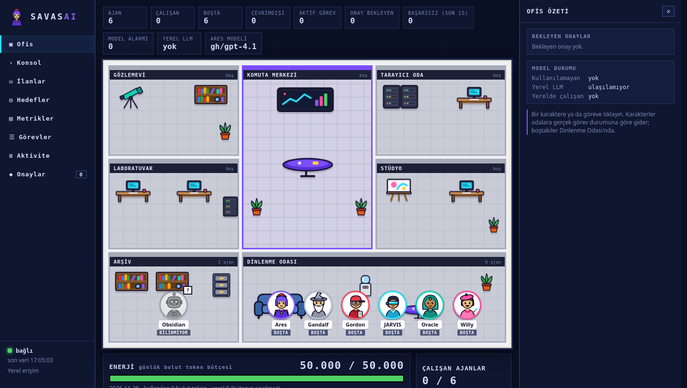
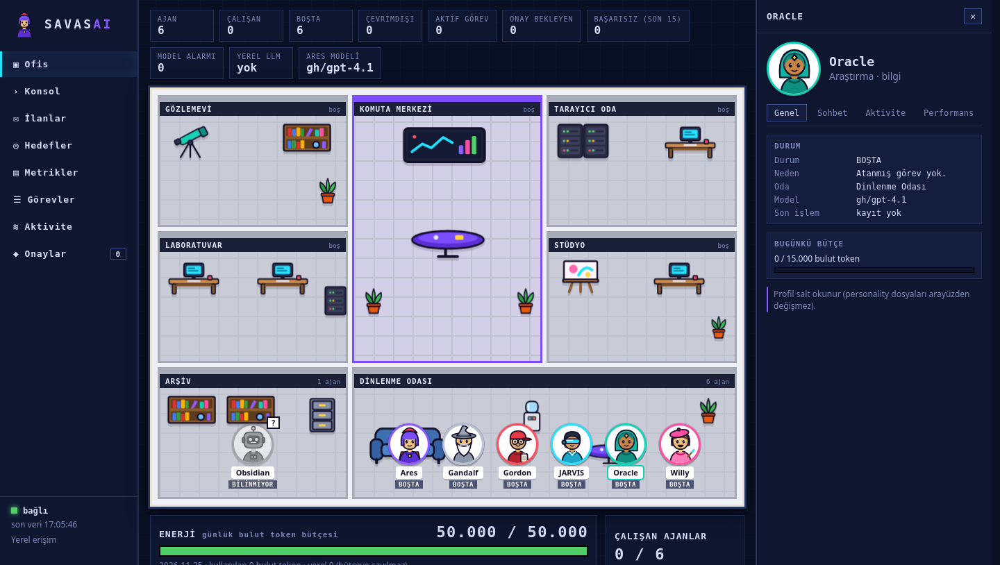
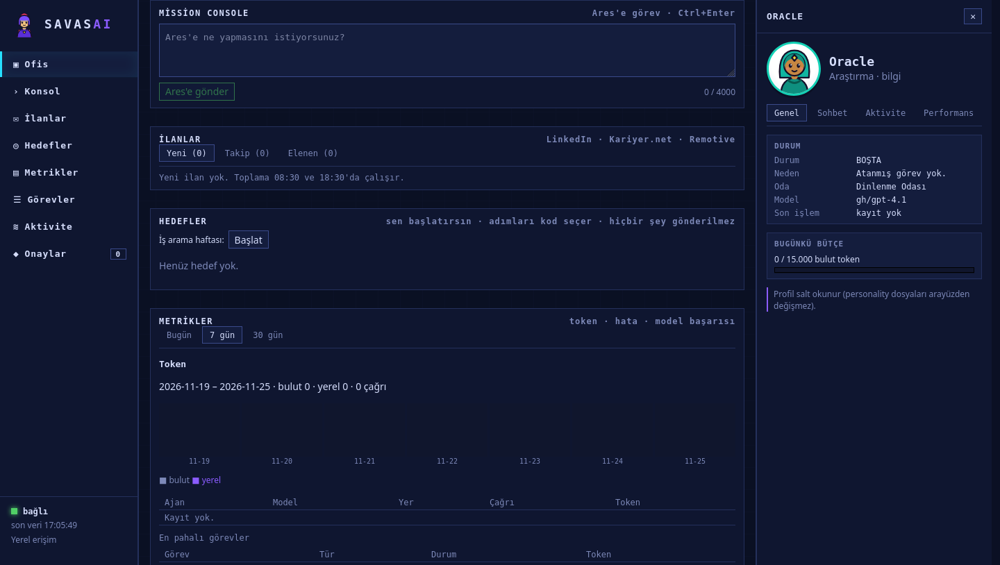

# SAVAS AI

A self-hosted, single-user AI agent platform. An orchestrator agent (**Ares**) takes a task, splits it across specialist LLM workers, keeps every write behind a human approval step and enforces token budgets, all on a home server with nothing exposed to the internet.



## What it does

- **Delegation with a dependency graph.** Ares hands sub-tasks to workers through a `delegate_to_workers` tool. Tasks can declare `depends_on`, so they run in layers, and `review_by` sends a result to a second worker for review.
- **Approval Layer.** Nothing is written (vault notes, code patches) until the user approves it. Auto-approval policies exist but are never persisted.
- **Token budgets and model routing.** There are daily budgets per agent, per task and per request, plus a completion reserve. A model registry maps task types to models, with a fallback chain and a circuit breaker on 429 and quota errors. A local model takes over when the cloud budget runs low.
- **Research.** Web search with sources (Tavily). After approval, the report is saved as a note in an Obsidian vault.
- **Long-term memory.** Facts are stored in SQLite with FTS5 and expire based on importance. Conflicting facts are flagged for the user instead of being overwritten.
- **Job search pipeline.** It reads job-alert emails over IMAP (read-only) and imports remote listings, then runs a rule-based filter. A worker scores each listing for fit. For a chosen listing it builds an application package: a tailored CV and cover letter, reviewed by another worker, exported to DOCX. Nothing is sent automatically.
- **Sandboxed code tasks.** A host-side runner works on throwaway copies of a repository and runs the tests in a container with no network. It returns a diff; the patch is applied only by a script the user runs.
- **Goals, background tasks, recovery.** Goals are recipe-based and token-capped. Background tasks use idempotency keys. After a restart, tasks left running or queued are marked as failed rather than silently resumed.
- **PWA dashboard.** A password-protected web app with Web Push notifications. The Web Push encryption and VAPID signing (RFC 8291 / 8292) are implemented in-house.

| Worker panel | Mission console, job listings, goals, metrics |
|---|---|
|  |  |

## Architecture

```
            browser / phone (PWA, Web Push)
                        │  password login
                        ▼
              ceo-gateway  :18010 ──── allow-listed proxy
                        │
                        ▼
   orchestrator (Ares) :18000 ── SQLite (tasks, memory, FTS5)
     │          │          │
     │          │          └── savas-runner (host, unix socket) ── no-network test container
     │          └── obsidian-agent :18001 ── Obsidian vault (Markdown)
     └── model router ── OmniRoute (cloud models) │ llama.cpp (local fallback)
```

All ports are bound to `127.0.0.1`. Remote access is tailnet-only.

| Component | Tech | Responsibility |
|---|---|---|
| `orchestrator/` | Python 3.12, FastAPI, httpx, pydantic, sqlite3 | Task engine, delegation, model router, budgets, approvals, memory, job pipeline; serves the UI |
| `gateway/` | FastAPI, `cryptography` | Login (scrypt, HMAC-signed session cookie, lockout), allow-listed proxy, Web Push sender. Read-only container with all capabilities dropped |
| `agents/obsidian/` | FastAPI | Read, search, create and move notes, restricted to one vault folder |
| `runner/` | Python stdlib, systemd user service | Fixed jobs only (prepare, test, diff, clean up) on repository copies |
| `automations/` | Python, systemd timers | Daily summary, job collection, weekly report |
| `ui/` | Vanilla JS, HTML, CSS | Single-page dashboard; no framework, no build step, no CDN |
| `local-llm/` | llama.cpp `llama-server` | CPU-only local fallback model |

### Workers

| Worker | Role |
|---|---|
| **Ares** | Orchestrator: plans, calls tools, delegates |
| **JARVIS** | Coding |
| **Oracle** | Research; scores job listings |
| **Gordon** | Review (default reviewer in review chains) |
| **Willy** | Writing |
| **Gandalf** | General tasks, alternate reviewer |

## Security choices

- Secrets live in `secrets/*.env` with permissions that allow only the user to read them, and never in the repository. The orchestrator has no Docker socket access.
- Containers mount only the folders they need, never the whole home directory.
- The gateway forwards only an allow-listed set of routes and checks request origin on login.
- The code runner cannot run arbitrary commands. It offers a fixed set of jobs, blocks secret patterns in copied files, and runs tests with networking disabled.

## Running

```bash
# 1. secrets (example names; values never committed)
mkdir -p secrets && chmod 700 secrets
bash scripts/set_ui_password.sh        # gateway login
bash scripts/set_ui_push_keys.sh       # VAPID keys for Web Push
# 2. services
docker compose up -d --build
# 3. optional: host runner and scheduled automations
bash scripts/install_automations.sh
```

The UI is then available at `http://127.0.0.1:18010/`.

## Tests

There are 40 test files (pytest): 35 for the orchestrator, plus tests for the gateway, the runner and the automations.

```bash
python -m pytest -q orchestrator/tests gateway/tests runner/tests automations/tests
```

## Notes

The UI and the agents' prompts are in Turkish. This is a personal project built for one user on one home server, not a hosted product.
